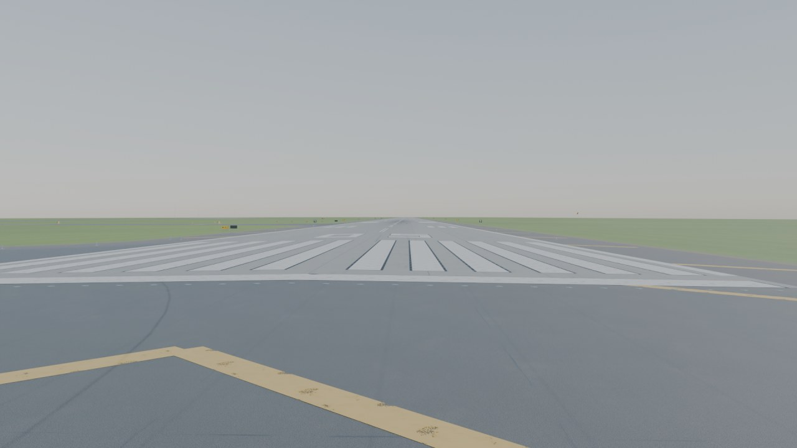
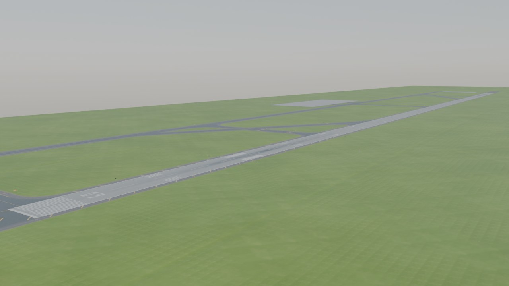
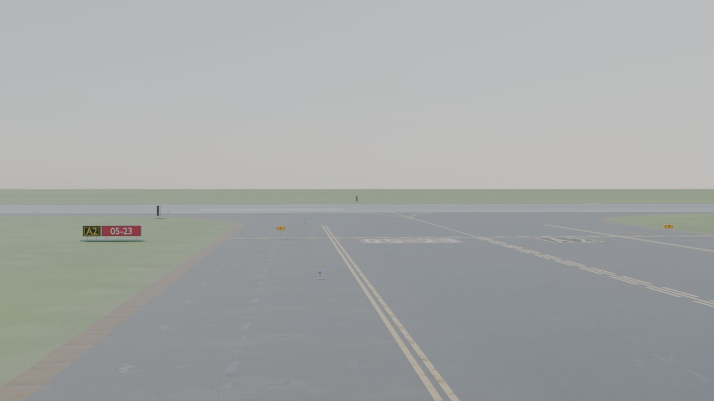
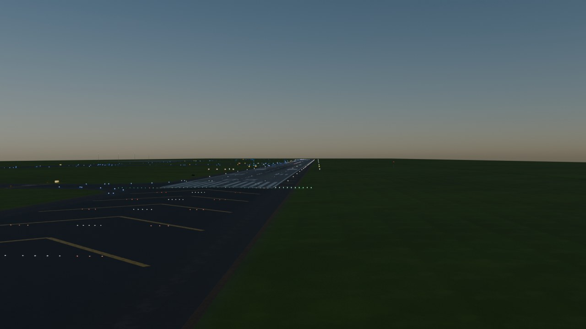
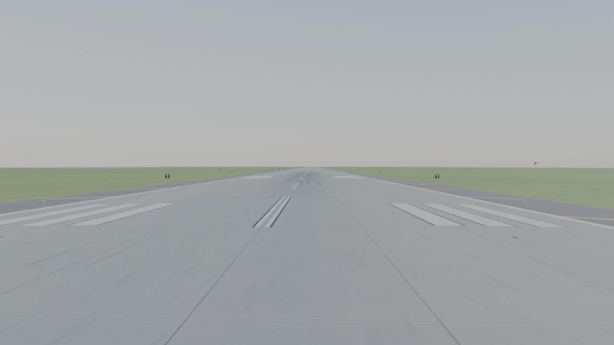
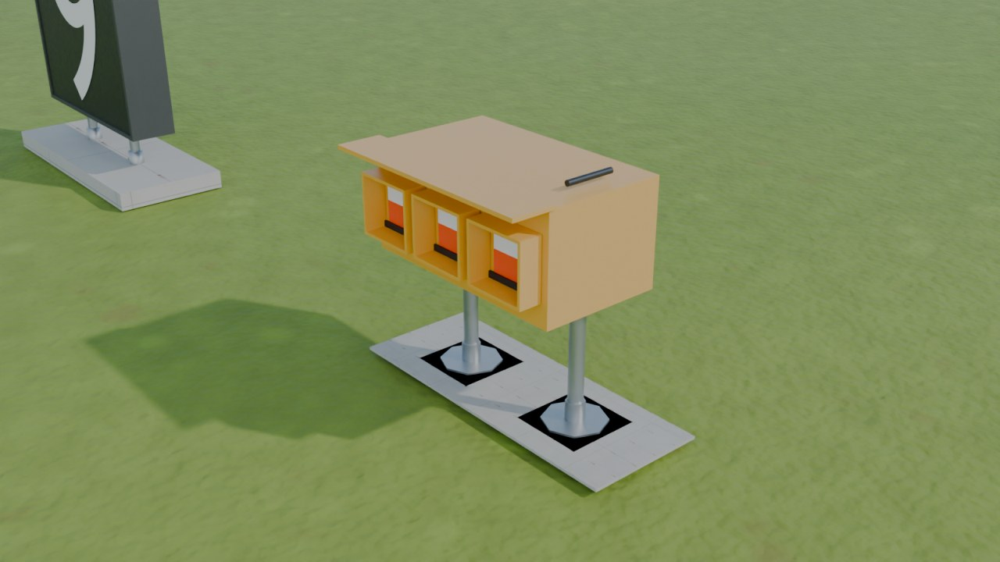
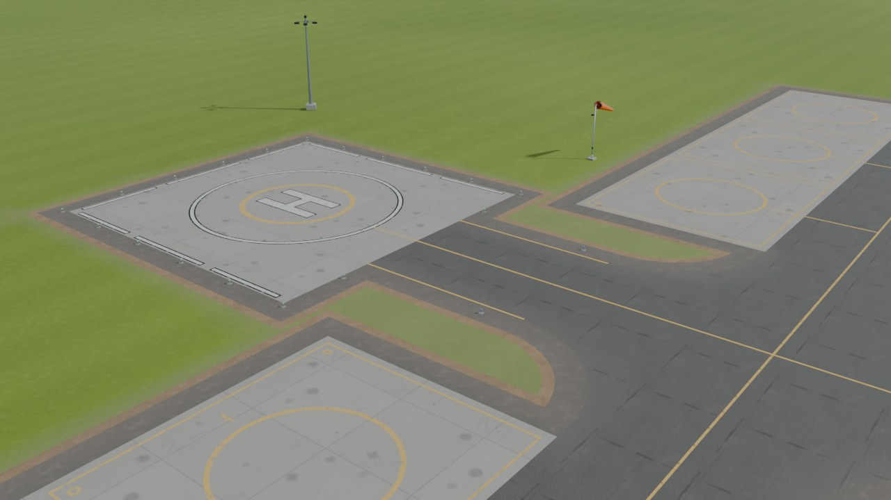
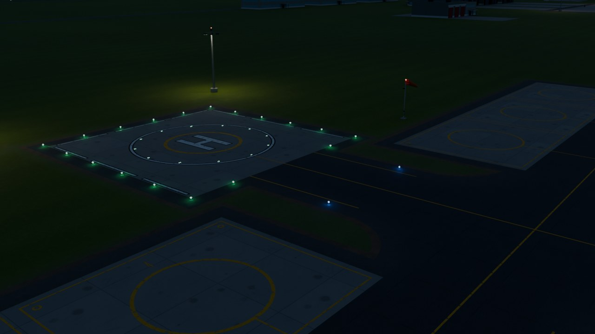

# Military Airbase Designer — Blender add-on

**Parametrik, oyuna hazır (game-ready), PBR dokulu askeri hava üssü pist üreteci.**
**Parametric, game-ready, PBR-textured military airbase runway generator for Blender 4.2+ / 5.x.**

[Türkçe](#türkçe) · [English](#english)

---

## Türkçe

### Ne yapar?

Tek tıkla gerçek standartlara (UFC 3-260-01, UFC 3-260-04, UFC 3-535-01, FAA AC 150/5340-1M, ICAO Annex 14 / NATO STANAG 3158) göre
ölçülendirilmiş, eksiksiz bir askeri hava üssü üretir:

| Katman | İçerik |
|---|---|
| **Kaplama** | Pist (PCC beton / asfalt / hibrit), %1,5 merkez eğimli (crown) yüzey, banketler, 1.000 ft kaplamalı aşma sahaları (overrun), paralel taksi yolu, dik bağlantılar, 30° yüksek hızlı çıkışlar (1.500 ft yay), UFC Tablo 5-4 fillet yarıçapları, apronlar, HAS döngü taksi yolları, EOR (arm/de-arm) pedleri, yollar, toprak şerit ve arazi |
| **Heliport ve helitaksi yolları** | Tasarım helikopteri sınıfından (hafif / taarruz / orta / ağır) boyutlanan FATO + TLOF pedi (yuvarlak veya kare TLOF, kaplamalı veya çim FATO), ana taksi yoluna bağlanan helitaksi yolu, omurga üzerinde sürekli park sıraları (en çok 8 park yeri), kavşak fileleri; H, TLOF çevresi, kesik FATO çevresi, sarı iniş/konumlandırma dairesi, merkez/kenar çizgileri, park yeri daireleri + numaraları, FATO/TLOF yeşil çevre ışıkları, mavi kenar ışıkları, projektör direkleri, rüzgâr çorabı. **Dörtgen (quad) topoloji**: dikdörtgenler tensör ızgara, yuvarlak TLOF O-grid, FATO halkası loft, kavşak fileleri tek sıra quad yama (yalnızca fileler başına iki uç üçgen); komşu ızgaralar sınır köşelerini paylaşır (T-kavşak ve çatlak yok) |
| **İşaretlemeler** | Pist tanıtım rakamları (FAA/UFC blok fontu), eşik çizgileri, eşik çubuğu, hedef noktası, teker koyma bölgesi (3-2-2-1-1), merkez hattı, kenar çizgileri, banket "aldatıcı yüzey" çizgileri, overrun şevronları, tutucu kablo diskleri, kaydırılmış eşik okları, taksi yolu merkez/kenar çizgileri ve lead-on eğrileri, bekleme noktası A/B desenleri, geliştirilmiş merkez hattı, yüzeye boyanmış bekleme/konum tabelaları, apron lead-in çizgileri, durma çubukları, park numaraları, bağlama/topraklama noktaları, hidrant kareleri, helipad H + TLOF, pusula kalibrasyon pedi, yol çizgileri. Boya aşınması (lastik izi, çatlama) vertex rengi + maske dokusu ile |
| **Çıkartmalar (decal)** | Teker koyma bölgesinde ana iniş takımı izlerine göre lastik izleri (trafik karışımı: avcı / karışık / ağır; iniş yönü payı, teker koyma mesafesi ve yayılımı ayarlanır), frenleme izleri, çıkışlarda dönüş sürtme izleri, park yerlerinde yağ/hidrolik lekeleri, kir halkası ve egzoz isi. Tek alfa-karışımlı mesh, 4×4 hücreli `T_MAD_Decals` atlası, çıkartma başına opaklık vertex alfasında |
| **Aydınlatma** | HIRL kenar ışıkları (son 2.000 ft amber), eşik/pist sonu ışıkları (yeşil/kırmızı), merkez hattı ışıkları (beyaz → kırmızı/beyaz → kırmızı), TDZ barretleri, PAPI, REIL, ALSF-2 / ALSF-1 / MALSR / SSALR / ODALS yaklaşma ışık sistemleri, mavi taksi yolu kenar ışıkları, yeşil merkez hattı ışıkları, pist koruma ışıkları (wig-wag), stop bar, apron projektör direkleri, fener; gece modu (emissive) |
| **Tabela & görsel yardımcılar** | Bekleme noktası tabela dizileri (kırmızı/beyaz + siyah/sarı), yön tabelaları, kalan pist mesafesi (RDR) tabelaları, tutucu kablo işaretleyicileri (AGM), rüzgar tulumları ve segmentli daire |
| **Yapılar (isteğe bağlı)** | NATO 3. nesil HAS (3 stil, kamuflaj), siperler, hangarlar, kontrol kulesi, itfaiye, karargâh binaları, yakıt çiftliği, mühimmat sahası (igloo), BAK-12 tutucu sistem (kablo, donut'lar, absorber kulübeleri), jet blast deflektörü, hush house, ECP, nöbet kuleleri, navaid'ler (localizer, glide slope, TACAN, radar, AWOS), çift çevre çiti, devriye yolu |
| **Dokular** | 14 adet döşenebilir PBR seti (BaseColor / Normal / Roughness / AO / Height 16-bit + motor paketi ORM / MaskMap / MetallicSmoothness / MetallicRoughness), numpy ile tamamen prosedürel, 512–8K; plaka derzleri, enine oluklar, çatlaklar, yağ lekeleri, biçilmiş çim şeritleri, zincir örgü çit maskesi |
| **Dışa aktarma** | FBX / glTF / OBJ; Unreal / Unity / Godot eksen ve ölçek ön ayarları; örnekleri kategori bazında birleştirme; `_LOD0..2` zincirleri; `UCX_` çarpışma mesh'leri; dokuların kopyalanması; `material_index.json` + içe aktarma kılavuzu |

### Ekran görüntüleri

Varsayılan *Runway focus* ön ayarı, Cycles ile üretilmiş 2K dokularla (eklentinin kendi sentezleyicisi, dış kaynak yok):

| | |
|---|---|
|  |  |
|  |  |
|  |  |
|  |  |

### Kurulum

1. `python3 tools/build_extension.py` ile `dist/military_airbase_designer-1.0.0.zip` üretin (veya depodan hazır zip'i indirin).
2. Blender 4.2+: **Edit ▸ Preferences ▸ Get Extensions ▸ ⌄ ▸ Install from Disk…** ile zip'i seçin.
   (Blender 4.0/4.1 için **Add-ons ▸ Install** de çalışır.)
3. 3B görünümde **N** paneli ▸ **Airbase** sekmesi.

Arayüz dilini **Preferences ▸ Interface ▸ Language ▸ Türkçe** ile ya da eklenti tercihlerindeki *Panel language* seçeneğiyle Türkçe yapabilirsiniz (tüm özellik adları ve ipuçları çevrilmiştir).

### Hızlı başlangıç

1. **Airbase** panelinde bir ön ayar seçin (varsayılan: *Runway focus* — pist + taksi yolları + bir apron, binalar kapalı) ve **Build Full Base**'e basın. Üs, 3B imlecin bulunduğu yerde, pist başlığına göre döndürülmüş olarak üretilir (origin pist merkezi, +X düşük numaralı baştan yüksek numaralı başa).
2. Alt panellerden parametreleri değiştirin (**Runway**, **Markings**, **Decals & Wear**, **Taxiways**, **Aprons & Pads**, **Heliports & Helitaxiways**, **Lighting**, **Signage**, **Structures**, **Perimeter & Terrain**, **Materials & Textures**, **Export**). **Live update** açıkken her değişiklik üssü otomatik yeniden kurar; kapalıyken **Rebuild**'e basın.
3. **Generate Textures** tam çözünürlüklü doku setlerini doku klasörüne yazar (`//textures/` varsayılan). İlk kurulumda 512 px önizleme dokuları otomatik üretilir.
4. **Export ▸ Export Game Asset** ile seçtiğiniz motor ön ayarında dışa aktarın; klasörde `README_export.txt` içe aktarma adımlarını anlatır.

### Ön ayarlar

`RUNWAY_FOCUS` (varsayılan), `USAF_CLASS_B_FIGHTER`, `USAF_CLASS_B_HEAVY` (12.000 × 200 ft tanker/airlift), `NATO_ICAO_4E_FIGHTER` (3.000 × 45 m, ICAO işaretleri),
`TR_INCIRLIK` (LTAG), `TR_MERZIFON` (LTAP), `TR_BALIKESIR` (LTBF), `TR_KONYA` (LTAN), `USAF_CLASS_A_TRAINER`, `MINIMAL_RUNWAY_ONLY`.
**Presets ▸ Save Preset** ile kendi ön ayarlarınızı kaydedebilirsiniz.

### Oyun motoru notları

* Birim: 1 Blender birimi = 1 m; Unreal için **Scale to centimetres** seçeneği.
* Vertex rengi `Wear`: R = lastik izi, G = kenar kiri, B = makro ton varyasyonu, A = boya aşınması. Motor malzemenizde bu kanalları kullanarak dokuların tekrarını kırabilirsiniz (`material_index.json` reçeteyi verir).
* Normal haritaları varsayılan DirectX (Y-) — Unity/Godot için **Materials ▸ DirectX normal** kapatın.
* İşaretlemeler ayrı "decal" mesh'leridir (kaplamanın 4 mm üstünde, maskeli saydamlık); lastik izi / leke çıkartmaları ise 5,5 mm'de tek bir alfa-karışımlı (BLEND) tabakadır. İsterseniz dışa aktarmada tek mesh'e birleştirilir.

### Geliştirme / test

```bash
pip install bpy==4.2.0            # Blender'ı Python modülü olarak kurar (headless)
python3 tests/harness.py --preset RUNWAY_FOCUS --render tests/_out/test.png --camera threshold
python3 tests/harness.py --modules pavement,markings --quality PREVIEW
```

`tests/harness.py` eklentiyi gerçek bir Blender script dizini üzerinden etkinleştirir, bir ön ayarı kurar, istatistik/uyarıları yazdırır ve Cycles ile render alır (4.2 ve 5.0 ile test edilmiştir).

### Mimari

`docs/ARCHITECTURE.md` modül yapısını anlatır: `core/` (geometri çekirdeği, veri modeli), `layout/plan.py` (bpy'den bağımsız yerleşim planı — tek doğruluk kaynağı), `geometry/` (kaplama, işaretlemeler, aydınlatma, tabela, yapılar, çevre, navaid, arazi), `textures/` (numpy gürültü + sentez + PNG I/O), `materials/` (PBR düğüm ağaçları), `ops/`, `ui/`, `i18n/`.

---

## English

### What it does

Generates a complete military airbase dimensioned to real standards (UFC 3-260-01, UFC 3-260-04, UFC 3-535-01, FAA AC 150/5340-1M,
ICAO Annex 14 / NATO STANAG 3158) with one click:

* **Pavement** — PCC / asphalt / hybrid runway with a 1.5 % crown, paved shoulders, 1,000 ft paved overruns, parallel taxiway, right-angle connectors, 30° high-speed exits (1,500 ft arc), UFC Table 5-4 fillets, aprons, HAS loop taxiways, EOR pads, roads, dirt strip and terrain with drainage swales.
* **Heliports & helitaxiways** — FATO + TLOF pad sized from the design helicopter (light / attack / medium / heavy; round or square TLOF, paved or turf FATO), a helitaxiway joining the parallel taxiway, continuous parking rows on a spine (up to 8 stands), junction fillets; H, TLOF perimeter, dashed FATO perimeter, yellow touchdown / positioning circle, centre and edge lines, stand circles + numbers, green FATO / TLOF perimeter lights, blue edge lights, floodlight masts and a windsock. **Quad topology**: tensor grids for rectangles, an O-grid for a round TLOF, a loft ring out to the FATO, junction fillets as single-row quad patches (only two cusp triangles per fillet); neighbouring grids share their boundary vertices (no T-junctions, no cracks). Dimensions are rule-of-thumb values in the spirit of ICAO Annex 14 Vol II / FAA AC 150/5390-2C / UFC 3-260-01 — verify them before a real design.
* **Markings** — designators (FAA/UFC block font), threshold stripes and bar, aiming point, touchdown zone (3-2-2-1-1), centreline, side stripes, shoulder stripes, overrun chevrons, arresting-gear discs, displaced-threshold arrows, taxiway centre/edge lines with lead-on curves, hold position patterns A/B, enhanced centreline, surface painted signs, apron lead-ins, stop bars, spot numbers, tie-downs, hydrants, helipad H/TLOF, compass rose, road lines; paint wear through vertex colour + mask texture.
* **Decals** — touchdown skid marks on the main-gear tracks of the traffic mix (fighter / mixed / heavy; landing-direction share, touchdown distance and spread), braking streaks, turn scuffs at exits, oil/hydraulic stains, grime halos and exhaust soot on apron spots; one alpha-blended mesh over a 4×4 `T_MAD_Decals` atlas, per-decal opacity in the vertex alpha.
* **Lighting** — HIRL edge lights (amber caution zone), threshold/end, centreline (colour coded), TDZ barrettes, PAPI, REIL, ALSF-2 / ALSF-1 / MALSR / SSALR / ODALS, taxiway edge and centreline lights, runway guard lights, stop bars, apron floodlights, beacon; night mode.
* **Signage** — hold position arrays, direction/location signs, runway distance remaining signs, arresting gear markers, wind cones.
* **Structures (optional)** — NATO 3rd-generation HAS (three styles, camouflage), revetments, hangars, control tower, fire station, ops buildings, fuel farm, munitions igloos, BAK-12 arresting system, jet blast deflectors, hush house, ECP, guard towers, navaids, double perimeter fence and patrol road.
* **Textures** — 14 seamless procedural PBR sets (BaseColor / Normal / Roughness / AO / 16-bit Height + ORM / MaskMap / MetallicSmoothness / MetallicRoughness packing), 512–8K, pure numpy.
* **Export** — FBX / glTF / OBJ with Unreal / Unity / Godot presets, instance joining, `_LOD` chains, `UCX_` collision, texture copying and a `material_index.json` recipe.

### Screenshots

Default *Runway focus* preset rendered in Cycles with the add-on's own 2K synthesized textures (no external assets):

| | |
|---|---|
|  |  |
|  |  |
|  |  |
|  |  |

### Install

1. Build `dist/military_airbase_designer-1.0.0.zip` with `python3 tools/build_extension.py` (or download the release zip).
2. Blender 4.2+: **Edit ▸ Preferences ▸ Get Extensions ▸ ⌄ ▸ Install from Disk…** and pick the zip. (Blender 4.0/4.1: **Add-ons ▸ Install**.)
3. 3D Viewport ▸ **N** panel ▸ **Airbase** tab.

### Quick start

Pick a preset (default *Runway focus*: runway, taxiways, one apron, structures off), press **Build Full Base**, then tune the sub-panels. **Live update** rebuilds on every change; otherwise press **Rebuild**. **Generate Textures** writes the full-resolution PBR sets; **Export Game Asset** writes a self-contained folder for your engine.

### Presets

`RUNWAY_FOCUS` (default), `USAF_CLASS_B_FIGHTER`, `USAF_CLASS_B_HEAVY`, `NATO_ICAO_4E_FIGHTER`, `TR_INCIRLIK`, `TR_MERZIFON`, `TR_BALIKESIR`, `TR_KONYA`, `USAF_CLASS_A_TRAINER`, `MINIMAL_RUNWAY_ONLY`; user presets via **Presets ▸ Save Preset**.

### Development

```bash
pip install bpy==4.2.0
python3 tests/harness.py --preset RUNWAY_FOCUS --render tests/_out/test.png --camera threshold
```

See `docs/ARCHITECTURE.md` for the module layout and `docs/IMPLEMENTER_BRIEF.md` for the contribution rules.

### License

GPL-3.0-or-later (Blender add-on requirement).
